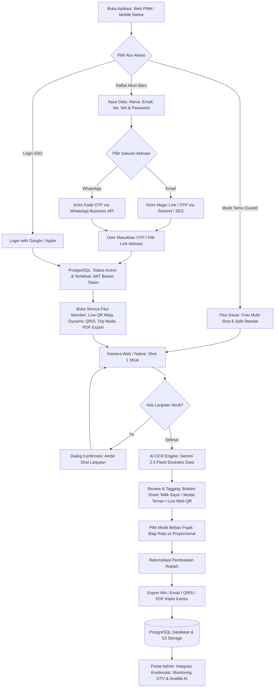

# Master Plan: Aplikasi SplitBill (Smart Receipt OCR, Collaborative Split, JWT Security, PostgreSQL, Responsive & PWA)

Dokumen ini merupakan cetak biru (*master plan*) arsitektur sistem, spesifikasi fungsional, logika bisnis, model akses berjenjang (*User Tiering*), arsitektur keamanan (*JWT Bearer Token*), integrasi pihak ketiga (*OAuth Google & Apple*), sistem verifikasi aktivasi akun multi-channel (*Email & WhatsApp*), pilihan teknologi definitif (*Production Tech Stack* dengan basis database **PostgreSQL**), desain responsif adaptif & kemampuan **Progressive Web App (PWA)**, serta portal pengelola (*Admin Backoffice & Analytics*) untuk aplikasi **SplitBill**.

---

## 1. Ringkasan Eksekutif & Visi Produk

### 1.1 Visi Solusi
Aplikasi **SplitBill** adalah platform pemindaian dan pembagian tagihan cerdas yang mentransformasi struk fisik makanan/minuman menjadi kalkulasi finansial adil, transparan, aman, dan terotomasi.

Sistem melayani dua sisi ekosistem:
1. **Sisi Pengguna (Client Application):** Memberikan kemudahan pemindaian kamera beruntun (*multi-shot*), penandaan tag nama (*item tagging*), pembagian beban non-barang fleksibel, kolaborasi meja *real-time*, hingga penagihan terintegrasi QRIS. Aplikasi dirancang **Mobile-First Responsive** dan mendukung **PWA (Progressive Web App)** sehingga dapat diakses instan tanpa hambatan instalasi toko aplikasi.
2. **Sisi Pengelola (Admin Backoffice & Analytics):** Portal terpisah dengan kontrol akses khusus (*Role-Based Access Control*) untuk mengonfigurasi integrasi pihak ketiga (Google, Apple, Gateway Email/WhatsApp), memantau performa OCR AI, volume transaksi, tren kuliner/restoran, kesehatan sistem, dan manajemen pengguna.

---

## 2. Model Hak Akses & Tingkatan Pengguna (User Tiering)

Untuk memberikan kenyamanan maksimal sekaligus mendorong konversi pengguna, aplikasi menerapkan pembagian dua tingkat akses:

```
+-----------------------------------------------------------------------------------+
|                            TINGKAT AKSES APLIKASI                                 |
+------------------------------------------+----------------------------------------+
|   GUEST / MODE TANPA AKUN                |   MEMBER / PENGGUNA TERDAFTAR          |
|   (Bebas Coba Langsung)                  |   (Wajib Registrasi & Terverifikasi)   |
+------------------------------------------+----------------------------------------+
| - Single / Multi-Shot OCR Dasar          | - SEMUA FITUR GUEST +                  |
| - Penandaan Tag "Milik Saya"             | - Keamanan JWT Token & Multi-Device    |
| - Modal Popup Tambah Teman Ad-hoc        | - Live Session Web QR (Centang Sendiri)|
| - Mode Beban: Bagi Rata vs Proporsional  | - Dynamic QRIS & Tracker Bukti Transfer|
| - Rekonsiliasi Pembulatan Rupiah         | - Trip Mode & Debt Simplification      |
| - Salin Pesan Format Teks WhatsApp       | - Export Laporan Reimbursement (PDF)   |
| - Penyimpanan Riwayat Lokal Sementara    | - Gentle Payment Reminder Otomatis     |
|                                          | - Promo Bundling (BOGO) & Custom Slider|
|                                          | - Cloud Sync Antar Perangkat & Arsip   |
+------------------------------------------+----------------------------------------+
```

### 2.1 Mode Tamu (Guest Mode - Tanpa Registrasi)
- Pengguna dapat langsung membuka aplikasi dan memindai struk tanpa login atau verifikasi.
- Teman yang di-tag tidak memerlukan akun (cukup diinput nama & email via modal popup ad-hoc).
- Data disimpan di memori lokal (*Local-First Storage*).

### 2.2 Mode Pengguna Terdaftar (Registered Member - Wajib Pendaftaran & Verifikasi)
Untuk membuka kemampuan mutakhir (*Advanced & Collaborative Capabilities*), pengguna melakukan registrasi cepat dengan aktivasi akun wajib via Email atau WhatsApp.

---

## 3. Arsitektur Keamanan, Autentikasi & Integrasi Pihak Ketiga

```
+-----------------------------------------------------------------------------------+
|                     SECURITY & AUTHENTICATION ARCHITECTURE                        |
+-----------------------------------------------------------------------------------+
|                                                                                   |
|  [ REGISTRASI / LOGIN ]                                                           |
|  ├── Form Registrasi Mandiri (Email / No. WhatsApp)                               |
|  └── Single Sign-On (SSO): [Login with Google] & [Sign in with Apple]             |
|              │                                                                    |
|              ▼                                                                    |
|  [ VERIFIKASI AKTIVASI AKUN ] (Wajib Sebelum Akun Aktif)                          |
|  ├── Jalur Email: Magic Link / 6-Digit OTP (via SendGrid / AWS SES / Resend)      |
|  └── Jalur WhatsApp: 6-Digit OTP (via Official WhatsApp Business API / Gateway)   |
|              │                                                                    |
|              ▼                                                                    |
|  [ ISSUANCE JWT BEARER TOKEN ]                                                    |
|  ├── Access Token: Short-Lived (15-30 menit) -> Authorization: Bearer <token>     |
|  └── Refresh Token: Long-Lived (7-30 hari) -> HTTP-Only Secure Cookie / Keychain  |
|              │                                                                    |
|              ▼                                                                    |
|  [ API GATEWAY & RBAC AUTHORIZATION ]                                             |
|  ├── Verifikasi Signature & Expiry Token                                          |
|  ├── Role-Based Access Control (Guest, Member, Admin, Superadmin)                 |
|  └── Rate Limiting & Anomaly Detection                                            |
+-----------------------------------------------------------------------------------+
```

### 3.1 Keamanan Autentikasi dengan JWT Bearer Token
Setiap komunikasi klien ke API yang dilindungi harus menyertakan header:
```http
Authorization: Bearer <access_token>
```

Spesifikasi Token JWT:
1. **Access Token (Short-Lived):**
   - Masa berlaku: 15–30 menit.
   - Payload terenkripsi standar (JWS): `sub` (User ID), `email`, `role` (`member` / `admin`), `tier`, `permissions`, `iat`, `exp`.
2. **Refresh Token (Long-Lived):**
   - Masa berlaku: 7–30 hari.
   - Disimpan di media aman: `HttpOnly`, `SameSite=Strict`, `Secure` Cookie (pada Web) atau *Keychain / Encrypted SecureStore* (pada Mobile iOS/Android).
   - Dilengkapi mekanisme **Refresh Token Rotation & Invalidation** (mencegah *token replay attack*). Saat user melakukan *logout*, refresh token otomatis di-revoke pada database PostgreSQL / Redis.

### 3.2 Alur Registrasi & Verifikasi Aktivasi Akun (Email & WhatsApp)
Setiap pengguna yang mendaftar secara mandiri wajib melakukan aktivasi akun sebelum dapat login dan menggunakan fitur Member:
1. **Pendaftaran:** Pengguna mengisi Nama Lengkap, Email, Nomor WhatsApp, dan Password.
2. **Status Akun Awal:** Berstatus `pending_verification`.
3. **Pengiriman Kode Aktivasi:**
   - **Saluran Email:** Sistem mengirimkan email formal berisi tautan aktivasi 1-klik (*Magic Link*) dan kode OTP 6 digit (berlaku 10 menit).
   - **Saluran WhatsApp:** Sistem mengirimkan pesan WhatsApp interaktif resmi berisi kode OTP 6 digit ke nomor pengguna.
4. **Validasi & Pengaktifan:**
   - Pengguna memasukkan kode OTP ke antarmuka aplikasi.
   - Setelah valid, status akun beralih menjadi `active`.
   - Sistem menerbitkan pasangan JWT Bearer Token dan mengarahkan pengguna ke beranda aplikasi.

### 3.3 Menu Konfigurasi Integrasi Pihak Ketiga (Third-Party Integrations)
Pengelola aplikasi (Admin) disediakan menu antarmuka khusus di portal Backoffice untuk mengelola kredensial dan konfigurasi integrasi pihak ketiga:
1. **Single Sign-On (SSO):**
   - **Login with Google:** Konfigurasi `Google Client ID`, `Client Secret`, dan `Authorized Redirect URIs` (Google Identity Services / OAuth 2.0).
   - **Sign in with Apple:** Konfigurasi `Apple Services ID`, `Team ID`, `Key ID`, dan berkas `.p8 Private Key` (wajib untuk memenuhi pedoman App Store).
2. **Gateway Komunikasi & Notifikasi:**
   - **Email Provider API:** Konfigurasi penyedia layanan email transaksional (SendGrid / AWS SES / Resend / Mailgun) lengkap dengan API Key, Sender Email, dan template email verifikasi.
   - **WhatsApp Business Gateway:** Konfigurasi Meta Cloud API / WhatsApp Gateway Partner (Twilio, Fonnte, Waha) mencakup Phone Number ID, Access Token, dan template pesan OTP terverifikasi.
3. **Payment & QRIS Switch:**
   - Konfigurasi integrasi Payment Gateway (Midtrans / Xendit) untuk pembuatan Dynamic QRIS otomatis.

---

## 4. Arsitektur Solusi & Komponen Utama

```
+-----------------------------------------------------------------------------------+
|                        ARSITEKTUR UTAMA SPLITBILL ECOSYSTEM                       |
+-----------------------------------------------------------------------------------+
|                                                                                   |
|  [ KLIEN PENGGUNA: RESPONSIVE & PWA ]          [ SISI PENGELOLA: ADMIN PORTAL ]   |
|  (PWA Next.js 15 & Mobile Expo SDK 52)         (Dedicated Next.js / Shadcn Admin) |
|  - Mobile-First Adaptive UI (Thumb-friendly)   - Konfigurasi Integrasi (Google,   |
|  - Kamera Web API & Native Multi-Shot            Apple, Email, WA Gateway)        |
|  - Offline Caching via Service Worker          - Platform Executive Metrics (GTV) |
|  - Live Table Session (Web QR Meja)            - OCR & AI Latency/Error Analytics |
|  - Settlement & QRIS Tracker                   - Merchant & Dining Insights       |
|  - Reimbursement PDF Generator                 - User Management & Quota Control  |
|  - Autentikasi JWT & Social Login              - System Audit Trail & Security    |
|                          \                           /                            |
|                           \                         /                             |
|                            v                       v                              |
|                       +---------------------------------+                         |
|                       |   API GATEWAY (FASTIFY / NODE)  |                         |
|                       | (Bearer Auth, RBAC, Rate Limit) |                         |
|                       +---------------------------------+                         |
|                                        |                                          |
|         +------------------------------+------------------------------+           |
|         |                              |                              |           |
|         v                              v                              v           |
|  +--------------+            +-------------------+            +---------------+   |
|  |  VISION OCR  |            |   FAIR-SHARE &    |            | COLLABORATION |   |
|  |  AI SERVICE  |            | OVERHEAD CALC ENG |            | & WEBSOCKET   |   |
|  | (Gemini 2.5) |            | (Equal/Proportnl) |            | (Live Sync)   |   |
|  +--------------+            +-------------------+            +---------------+   |
|         |                              |                              |           |
|         +------------------------------+------------------------------+           |
|                                        |                                          |
|                                        v                                          |
|                     +------------------------------------+                        |
|                     |     PERSISTENCE & STORAGE TIER     |                        |
|                     | - PostgreSQL 16+ (Prisma ORM)      |                        |
|                     | - S3 / Cloudflare R2 (Receipt Img) |                        |
|                     | - Redis 7+ (Sessions & Token Revoke|                        |
|                     +------------------------------------+                        |
+-----------------------------------------------------------------------------------+
```

---

## 5. Spesifikasi Fungsional Lengkap (Client Application)

### 5.1 Kamera Multi-Shot untuk Struk Panjang
- **Sequential Capture:** Memotret bagian 1 $\rightarrow$ Dialog konfirmasi: *"Apakah ada foto lanjutan untuk nota yang sama?"* $\rightarrow$ Ambil bagian 2, dst.
- **AI De-duplication & Stitching:** Menghilangkan baris teks tumpang tindih (*overlap*) antara ujung frame foto, menyatukan subtotal dan item ke dalam 1 nota transaksi utuh.

### 5.2 Penandaan Item (Item Tagging) & Onboarding Teman Cepat
- **Pintasan "Milik Saya" (Self-Assignment):** 1 klik untuk menandai makanan milik pengguna utama.
- **Modal Popup Teman Ad-hoc:** Saat menandai barang milik orang baru, muncul modal popup:
  - *Nama Lengkap* (Wajib)
  - *Email* (Wajib/Opsional untuk pengiriman invoice otomatis)
  - *No. WhatsApp* (Opsional)
  - *Simpan ke Kontak Cepat Lokal* untuk sesi makan berikutnya.
- **Peringkat Pemesan Terbanyak (*Top Spender Analytics*):** Menampilkan pemetaan siapa yang memesan terbanyak secara nominal dan porsi.

### 5.3 Fleksibilitas Alokasi Beban Non-Barang (Pajak, Servis, Diskon)
- **Mode 1: Bagi Rata (*Equal Overhead Split*):** Pajak dan servis dibagi sama rata ke semua orang (misal pajak Rp 5.000 dibagi 3 orang = masing-masing Rp 1.667).
- **Mode 2: Proporsional (*Proportional Overhead Split*):** Pajak dan servis mengikuti persentase nilai belanja barang masing-masing.
- **Rekonsiliasi Pembulatan Rupiah:** Penyesuaian nilai sen/rupiah ganjil agar total kumulatif 100% presisi dengan grand total struk kasir.

### 5.4 Kemampuan Khusus Pengguna Terdaftar (Member Capabilities)
1. **Live Table Collaboration (QR Meja):** Teman di meja memindai QR code via kamera HP $\rightarrow$ Web terbuka tanpa login $\rightarrow$ Teman mencentang makanannya sendiri secara *real-time*.
2. **Payer Selection & Dynamic QRIS:** Menetapkan siapa yang menalangi tagihan (*The Payer*) dan membuat QRIS dinamis dengan nominal yang terkunci sesuai tagihan masing-masing teman.
3. **Settlement & Bukti Transfer:** Teman mengunggah screenshot transfer; Payer memverifikasi status *Unpaid* $\rightarrow$ *Paid*.
4. **Trip Mode & Debt Simplification:** Menggabungkan banyak struk liburan dan meminimalkan jumlah transfer antar-anggota dengan graf penyederhanaan utang.
5. **Export Laporan Reimbursement Kantor:** Generator laporan formal PDF/Excel siap diajukan ke kantor lengkap dengan foto struk beresolusi optimal.

---

## 6. Desain Responsif Adaptif & Spesifikasi Progressive Web App (PWA)

Untuk memastikan kemudahan pemakaian (*high usability*) dan menghilangkan hambatan adopsi (*zero-friction*), aplikasi mengadopsi standar **Mobile-First Responsive** serta kapabilitas **PWA (Progressive Web App)** penuh:

```
+-----------------------------------------------------------------------------------+
|                        PWA & RESPONSIVE DESIGN CAPABILITIES                       |
+-----------------------------------------------------------------------------------+
| 1. Mobile-First Adaptive Layout (Optimal di Layar 360px HP hingga 4K Desktop)   |
| 2. Ergonomi Jempol (Bottom Sheets, Touch Targets 48px, Swipe Gestures)            |
| 3. Akses Perangkat via Web APIs (Kamera Lingkungan & File Capture)               |
| 4. Installable (A2HS - Add to Home Screen, Standalone Display, Zero App Store)   |
| 5. Offline Resilience via Service Worker (Cache First Assets & IndexedDB Drafts)  |
| 6. Web Push Notifications (Pengingat Pembayaran & Konfirmasi Pelunasan)          |
+-----------------------------------------------------------------------------------+
```

### 6.1 Adaptabilitas Perangkat & Ergonomi Antarmuka
1. **Mobile-First Breakpoint Architecture:**
   - **Compact Mobile (360px – 480px):** Tata letak kolom tunggal dengan panel kendali di bagian bawah layar (*bottom navigation* & *action sheet*) yang mudah dijangkau satu jempol tangan.
   - **Tablet / Foldable (768px – 1024px):** Tata letak *split-view* (daftar struk di sisi kiri, panel tagging & rincian orang di sisi kanan).
   - **Desktop / Laptop (> 1024px):** Tampilan dashboard tiga kolom (Pratinjau Struk Asli | Editor Item & Pajak | Rincian Rekap & Kartu Tagihan).
2. **Komponen Sentuh Nyaman (Touch-Optimized Elements):**
   - Area klik/sentuh tombol minimal berukuran **$48 \times 48\ \text{dp}$** untuk mencegah salah klik saat menandai item makanan.
   - **Bottom Sheet Modal:** Modal popup input teman baru muncul meluncur dari bawah layar ponsel (*slide-up bottom sheet*), bukan popup melayang kaku di tengah layar.
   - **Safe Area Insets:** Menghormati lekukan layar ponsel modern (*iPhone notch, Dynamic Island, dan Android gesture bar*) menggunakan variabel CSS `env(safe-area-inset-top)` dan `env(safe-area-inset-bottom)`.

### 6.2 Kemampuan PWA (Progressive Web App) Penuh
1. **Instalasi Cepat (Add to Home Screen - A2HS):**
   - Web App Manifest (`manifest.json`) standar W3C:
     ```json
     {
       "name": "SplitBill - Smart Receipt Split",
       "short_name": "SplitBill",
       "start_url": "/",
       "display": "standalone",
       "background_color": "#FFFFFF",
       "theme_color": "#2563EB",
       "icons": [
         { "src": "/icons/icon-192.png", "sizes": "192x192", "type": "image/png", "purpose": "any maskable" },
         { "src": "/icons/icon-512.png", "sizes": "512x512", "type": "image/png", "purpose": "any maskable" }
       ]
     }
     ```
   - Aplikasi dapat diinstal ke layar utama ponsel dalam 1 detik tanpa perlu membuka Google Play Store atau Apple App Store.
   - Tampilan berjalan dalam mode *standalone* tanpa bilah URL peramban, memberikan pengalaman visual yang identik dengan aplikasi native.
2. **Akses Kamera Langsung via Browser:**
   - Menggunakan API peramban modern `navigator.mediaDevices.getUserMedia({ video: { facingMode: 'environment' } })` untuk menampilkan pratinjau kamera resolusi tinggi langsung di halaman web.
   - Fallback otomatis ke atribut `<input type="file" accept="image/*" capture="environment">` bagi perangkat yang tidak mendukung stream video langsung.
3. **Ketahanan Offline & Jaringan Buruk Restoran (Offline Resilience):**
   - **Service Worker Caching (Workbox / Serwist):**
     - *Cache-First Strategy:* Aset statis aplikasi (HTML, CSS, JS, font, ikon) di-cache secara lokal sehingga aplikasi dapat terbuka dalam waktu < 0,5 detik bahkan saat koneksi internet lemah (*flaky restaurant Wi-Fi*).
     - *Local Draft Storage (IndexedDB):* Jika pengguna memotret struk di area restoran yang tidak memiliki sinyal, gambar dan draft kalkulasi disimpan secara aman di memori lokal ponsel dan otomatis disinkronkan (*Background Sync*) ketika internet kembali terhubung.
4. **Web Push Notifications:**
   - Mendukung pengiriman notifikasi dorong (*push notifications*) langsung ke perangkat pengguna (misal: notifikasi saat teman telah mentransfer uang atau pengingat tagihan ramah).

---

## 7. Portal Pengelola & Analitik (Admin Backoffice)

Portal Admin adalah aplikasi web independen yang hanya dapat diakses oleh staf berwenang (*Super Admin*, *Operations*, dan *Data Analyst*) dengan otentikasi JWT dan multi-faktor (MFA).

```
+-----------------------------------------------------------------------------------+
|                          MENU & FITUR ADMIN BACKOFFICE                            |
+-----------------------------------------------------------------------------------+
| 1. Third-Party Integrations Hub (Google, Apple OAuth, Email & WhatsApp Gateways)  |
| 2. Executive Dashboard (GTV, Total Bills, Active Users, Settlement Velocity)      |
| 3. OCR AI Performance Hub (Latency, Token Cost, Success Rate, Error Logs)        |
| 4. Merchant & Dining Intelligence (Top Restaurants, Average Spend, Tax Heatmap)   |
| 5. User & Subscription Management (Verification Status, Quota, Block/Unblock)     |
| 6. Security & Privacy Audit Trail (JWT Revocation, Ephemeral Clean-up, Activity)  |
+-----------------------------------------------------------------------------------+
```

### 7.1 Hub Konfigurasi Integrasi Pihak Ketiga (Third-Party Integrations Hub)
- **OAuth Provider Settings:** Formulir aman untuk memasukkan dan menguji kredensial Google Client ID/Secret dan Apple Service ID/Secret.
- **Communication Gateway Settings:** Pemilihan vendor pengiriman pesan (Email & WhatsApp), uji kirim pesan (*Test Delivery*), dan monitoring saldo kuota SMS/WA.
- **Payment Gateway Settings:** Pengaturan API Key penyedia QRIS/Virtual Account.

### 7.2 Dashboard Eksekutif & Metrik Platform
- **Gross Transaction Value (GTV):** Total volume perputaran uang dari seluruh tagihan yang diproses.
- **Total Bills Processed:** Jumlah struk berhasil per hari, minggu, dan bulan.
- **Settlement Velocity:** Rata-rata waktu penyelesaian tagihan sejak struk dipindai.

### 7.3 Pusat Analitik Performa OCR & AI (AI Performance Hub)
- **Akurasi & Success Rate:** Persentase ekstraksi struk tanpa banyak koreksi manual.
- **Latency & Biaya Token:** Waktu pemrosesan rata-rata (< 2,5 detik) dan monitoring biaya token Vision AI.
- **Log Kesalahan:** Pemantauan kegagalan scan dan pemicuan engine fallback.

### 7.4 Manajemen Pengguna & Verifikasi Akun
- **Daftar Akun Pengguna:** Melihat status akun (`pending_verification`, `active`, `suspended`), metode verifikasi (Email vs WhatsApp), dan riwayat sesi.
- **Aktivasi Manual & Kontrol Kuota:** Admin dapat mengaktifkan akun secara manual jika terdapat kendala pengiriman OTP dan mengatur batas kuota scan harian.

---

## 8. Pilihan Teknologi Definitif (Production Tech Stack)

Berikut adalah teknologi yang paling tepat, modern, dan telah teruji untuk membangun ekosistem aplikasi SplitBill secara tangguh, efisien, responsif, dan berskala besar:

| Lapisan Sistem | Teknologi Terpilih | Justifikasi Teknis & Alasan Pemilihan |
|---|---|---|
| **Database Utama** | **PostgreSQL 16+** | **Wajib & Sangat Tepat.** Relasional murni dengan jaminan ACID untuk integritas data keuangan. Memiliki dukungan tipe data `JSONB` yang sangat andal untuk menyimpan struktur item struk dinamis dan penyesuaian beban non-barang tanpa skema kaku, pengindeksan GIN/B-Tree cepat, serta ekosistem hosting yang matang. |
| **Database ORM & Migrasi** | **Prisma ORM** | *Object-Relational Mapping* tipe-aman (*Type-Safe*) untuk TypeScript. Menghasilkan skema deklaratif, auto-completion kode 100% presisi, dan migrasi otomatis yang bersih untuk relasi kompleks antara User, Transactions, Items, dan Audit Ledger. |
| **In-Memory Cache & Message Broker** | **Redis 7+** | Manajemen sesi pengguna, penyimpanan *blacklist* JWT token yang di-revoke, *rate limiting* pencegah spam API, serta *Pub/Sub WebSocket* untuk sinkronisasi centang pesanan *real-time* pada meja makan. |
| **Backend API Engine** | **Node.js (TypeScript) + Fastify** | Fastify dipilih karena memiliki *throughput* performa 2–3x lebih tinggi dibanding Express, arsitektur plugin modular, validasi skema otomatis berbasis JSON Schema / TypeBox, dan dukungan async/await modern. |
| **Vision OCR & AI Engine** | **Google Gemini 2.5 Flash API** | Menggunakan fitur *Structured JSON Output* (`responseSchema`). Sangat toleran terhadap struk kertas berkerut, format multi-kolom yang tidak rata, dan diskon bertingkat. Latency sangat cepat (~1.2 detik) dan biaya pemanggilan API per gambar paling ekonomis di kelasnya. |
| **Image Preprocessing** | **Sharp (Node.js)** | Pustaka pemrosesan gambar berbasis C++ (*libvips*) berkecepatan tinggi untuk auto-orientasi EXIF, konversi format WebP/JPEG, kompresi ukuran berkas, dan penyesuaian kontras sebelum gambar dikirim ke AI. |
| **Penyimpanan Objek / Foto Struk** | **Cloudflare R2** / **AWS S3** | Penyimpanan awan kompatibel API S3 dengan biaya egress nol (R2). Mendukung *presigned upload URLs* dan aturan *lifecycle auto-delete* (30 hari setelah pelunasan) demi kepatuhan privasi UU PDP. |
| **Frontend PWA & Web Client** | **Next.js 15 (App Router) + Serwist PWA + Tailwind CSS** | **Arsitektur PWA & Responsif Adaptif.** Menghasilkan aplikasi web responsif berkecepatan tinggi yang dapat diinstal langsung ke homescreen ponsel (*Add to Home Screen*), mendukung kamera web native, dan caching offline via Service Worker. |
| **Mobile Native App (Alternatif Store)** | **React Native (Expo SDK 52+)** | Untuk rilis resmi ke Google Play Store & Apple App Store. Berbagi logika kalkulasi dan tipe data yang sama dengan versi PWA web. |
| **Frontend Admin Backoffice** | **Next.js 15 + Shadcn UI + Recharts** | Antarmuka dashboard modern, responsif, dan elegan. Menggunakan komponen Shadcn UI (berbasis Radix UI) dan visualisasi grafik metrik eksekutif serta analitik AI menggunakan Recharts/Tremor. |
| **Gateway Komunikasi (Email & WA)** | **Resend / AWS SES** & **Meta WhatsApp Cloud API** | Resend menjamin *deliverability* email verifikasi masuk ke Inbox (bukan Spam). WhatsApp Cloud API resmi menjamin pengiriman OTP aktivasi akun secara instan (< 3 detik) ke ponsel pengguna. |
| **Gateway Pembayaran QRIS** | **Midtrans / Xendit API** | Pembuatan Dynamic QRIS otomatis dengan nominal terkunci untuk kemudahan transfer antar-anggota. |
| **Kontainerisasi & Deployment** | **Docker, Railway/AWS ECS & Vercel** | Docker untuk standarisasi environment backend dan PostgreSQL. Vercel untuk hosting frontend Next.js (Admin, PWA & Live Web), dan **EAS (Expo Application Services)** untuk kompilasi mobile store. |

---

## 9. Model Data & Skema Entitas Lengkap

```typescript
// Role Pengguna & Status Akun
export type UserRole = 'guest' | 'member' | 'admin' | 'superadmin';
export type AccountStatus = 'pending_verification' | 'active' | 'suspended';
export type VerificationChannel = 'email' | 'whatsapp';

// Konfigurasi Token Keamanan JWT
export interface AuthTokens {
  accessToken: string;       // JWT Bearer Token (15-30 mins)
  refreshToken: string;      // Secure Refresh Token (7-30 days)
  tokenType: 'Bearer';
  expiresIn: number;
}

// Konfigurasi Integrasi Pihak Ketiga (Admin Settings di PostgreSQL)
export interface ThirdPartyIntegrationConfig {
  oauth: {
    google: {
      enabled: boolean;
      clientId: string;
      clientSecret: string;
    };
    apple: {
      enabled: boolean;
      servicesId: string;
      teamId: string;
      keyId: string;
      privateKey: string;
    };
  };
  communication: {
    email: {
      provider: 'sendgrid' | 'aws_ses' | 'resend';
      apiKey: string;
      senderEmail: string;
      senderName: string;
    };
    whatsapp: {
      provider: 'meta_cloud_api' | 'twilio' | 'fonnte';
      phoneNumberId: string;
      apiToken: string;
    };
  };
}

// Profil Pengguna Terdaftar (Tabel: users di PostgreSQL)
export interface UserAccount {
  id: string;                // UUIDv4
  email: string;
  phoneNumber?: string;
  fullName: string;
  role: UserRole;
  status: AccountStatus;
  verificationChannel: VerificationChannel;
  avatarUrl?: string;
  defaultPaymentQrisUrl?: string;
  ocrQuotaRemaining: number;
  createdAt: string;
  verifiedAt?: string;
}

// Entitas Partisipan Sesi
export interface Participant {
  id: string;
  isSelf: boolean;
  userId?: string;           // Foreign Key ke users.id (jika punya akun)
  fullName: string;
  email?: string;
  phoneNumber?: string;
  avatarColor: string;
}

// Frame Multi-Shot Kamera
export interface ReceiptShotFrame {
  shotIndex: number;
  imageUrl: string;
  capturedAt: string;
}

// Baris Item Struk (Tersimpan sebagai JSONB di PostgreSQL)
export interface ReceiptItem {
  id: string;
  name: string;
  qty: number;
  unitPrice: number;
  totalPrice: number;
  assignedTags: {
    participantId: string;
    shareRatio: number;      // 1.0 = milik tunggal, 0.5 jika dibagi 2 orang
  }[];
}

// Strategi Alokasi Beban Non-Barang
export type OverheadSplitStrategy = 'equal' | 'proportional';

// Beban Non-Barang
export interface ReceiptAdjustment {
  subtotal: number;
  tax: number;
  serviceCharge: number;
  discount: number;
  rounding: number;
  grandTotal: number;
  overheadStrategy: OverheadSplitStrategy;
}

// Bukti Transfer & Pelunasan
export interface PaymentSettlement {
  participantId: string;
  amount: number;
  transferProofImageUrl?: string;
  status: 'unpaid' | 'pending_verification' | 'verified';
  verifiedAt?: string;
}

// Sesi Transaksi SplitBill Lengkap (Tabel: transactions di PostgreSQL)
export interface SplitBillTransaction {
  id: string;                          // UUIDv4
  ownerId?: string;                    // Foreign Key ke users.id (nullable jika guest)
  isLiveSession: boolean;
  liveSessionCode?: string;            // Kode / QR meja untuk join web
  merchantName: string;
  address?: string;
  locationCoords?: { lat: number; lng: number };
  shots: ReceiptShotFrame[];
  items: ReceiptItem[];                // JSONB
  adjustment: ReceiptAdjustment;        // JSONB
  participants: Participant[];          // JSONB
  settlements: PaymentSettlement[];    // JSONB / Relation
  status: 'draft' | 'active' | 'settled';
  createdAt: string;
}

// Metrik Analitik Backoffice Admin
export interface AdminAnalyticsSummary {
  period: 'day' | 'week' | 'month' | 'year';
  totalGtv: number;
  totalBillsProcessed: number;
  averageBillValue: number;
  ocrSuccessRate: number;
  averageAiLatencyMs: number;
  topMerchants: {
    merchantName: string;
    billCount: number;
    totalAmount: number;
  }[];
  userBreakdown: {
    totalRegistered: number;
    pendingVerification: number;
    guestActiveSessions: number;
  };
}
```

---

## 10. Desain Alur Pengguna & Sistem



---

## 11. Rencana Implementasi & Roadmap Pengembangan

### Fase 1: Fondasi PostgreSQL, Keamanan JWT, PWA Core & Autentikasi (Minggu 1 - 2)
- [x] Cetak biru Master Plan arsitektur lengkap.
- [ ] Setup database **PostgreSQL 16+** & konfigurasi skema **Prisma ORM**.
- [ ] Inisialisasi frontend **Next.js 15 PWA** dengan konfigurasi Service Worker (Serwist), Web App Manifest, dan styling responsif Mobile-First (Tailwind CSS).
- [ ] Implementasi backend API **Fastify (Node.js/TypeScript)** dengan autentikasi **JWT Bearer Token**.
- [ ] Alur registrasi & verifikasi aktivasi akun (Email via Resend & WhatsApp via Meta Cloud API).
- [ ] Implementasi Single Sign-On (SSO): Login with Google & Sign in with Apple.

### Fase 2: Core Engine, Kamera Web/Mobile Multi-Shot & OCR AI (Minggu 3 - 4)
- [ ] Komponen kamera adaptif (Web Camera API & Expo Camera) dengan dialog konfirmasi struk lanjutan.
- [ ] Pipeline preprocessing gambar menggunakan **Sharp**.
- [ ] Integrasi **Google Gemini 2.5 Flash** dengan schema JSON terstruktur untuk ekstraksi struk.
- [ ] Logika penggabungan (*stitching*) dan de-duplikasi baris teks struk panjang.
- [ ] Antarmuka responsif Bottom Sheet untuk Review & Item Tagging ("Milik Saya" & Modal Tambah Teman Ad-hoc).
- [ ] Modul kalkulasi Fair Split (Mode Bagi Rata vs Proporsional + Pembulatan Rupiah).

### Fase 3: Fitur Member Kolaboratif & Penyelesaian Tagihan (Minggu 5 - 6)
- [ ] Fitur **Live Collaborative Session** berbasis **WebSocket** (QR meja untuk teman centang sendiri via web ringan tanpa login).
- [ ] Integrasi **Dynamic QRIS Generator** (Midtrans/Xendit) dan panel upload/verifikasi bukti transfer.
- [ ] Fitur **Trip Mode** dan algoritma penyederhanaan utang (*Debt Simplification*).
- [ ] Generator **Laporan Reimbursement Kantor (PDF / Excel)**.
- [ ] Integrasi **Web Push Notifications** untuk pengingat pembayaran ramah.

### Fase 4: Portal Admin Backoffice & Analitik (Minggu 7 - 8)
- [ ] Setup web portal Admin dengan **Next.js 15 & Shadcn UI** dengan Role-Based Access Control (RBAC).
- [ ] Menu Konfigurasi Integrasi Pihak Ketiga (OAuth Google/Apple, Email Gateway, WA Gateway).
- [ ] Dashboard eksekutif: GTV, volume transaksi, dan kecepatan pelunasan (*settlement velocity*).
- [ ] Panel metrik OCR AI: Latency, error rate, dan token usage monitoring.
- [ ] Intelijen tren restoran & merchant terpopuler.
- [ ] Manajemen status verifikasi pengguna, kontrol kuota, dan kepatuhan privasi (UU PDP).

---

## 12. Kesimpulan

Master Plan ini kini mengintegrasikan **seluruh pilar teknologi produksi modern**:
- **Aksesibilitas Tanpa Batas:** Dirancang dengan prinsip **Mobile-First Responsive Design** dan kapabilitas **PWA (Progressive Web App)** lengkap (Add to Home Screen, akses kamera web langsung, dan ketahanan offline).
- **Database Kelas Industri:** **PostgreSQL 16+** dengan Prisma ORM yang menjamin keandalan transaksi finansial dan fleksibilitas JSONB.
- **Keamanan Kuat:** Berbasis **JWT Bearer Token** dan arsitektur token ganda (*Access & Refresh Token*).
- **Verifikasi Terpercaya:** Aktivasi akun multi-channel via **Email** dan **WhatsApp Business**.
- **Kemudahan Akses:** Dukungan **Login with Google** dan **Sign in with Apple**.
- **Kecerdasan Buatan Terdepan:** **Google Gemini 2.5 Flash** untuk ekstraksi data struk instan, akurat, dan hemat biaya.
- **Fleksibilitas Pengelolaan:** Menu konfigurasi pihak ketiga di **Portal Admin Backoffice** yang mandiri, disertai analitik operasional dan metrik performa AI secara menyeluruh.
